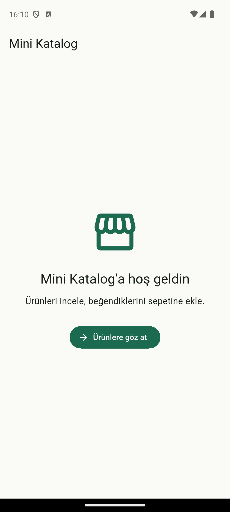
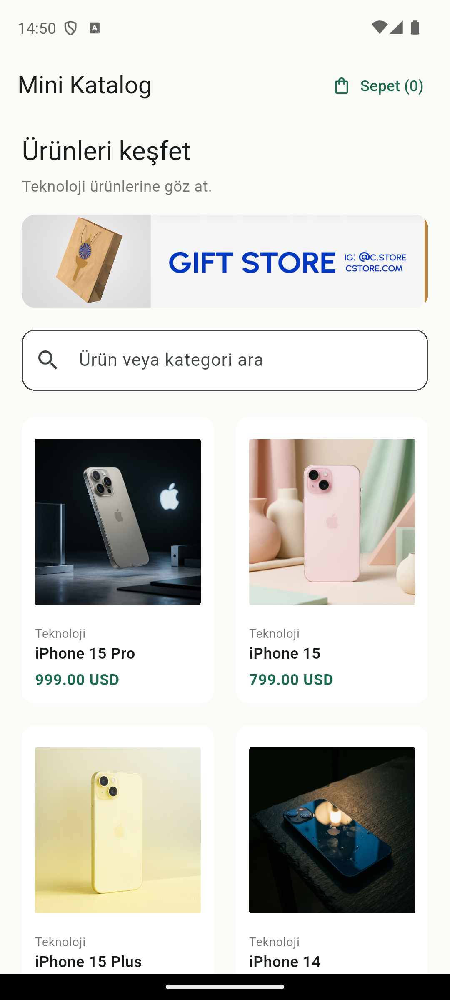
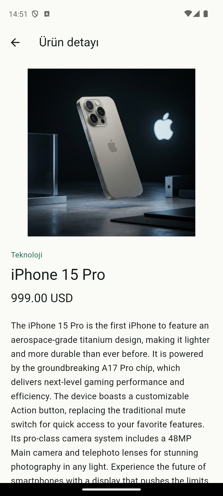
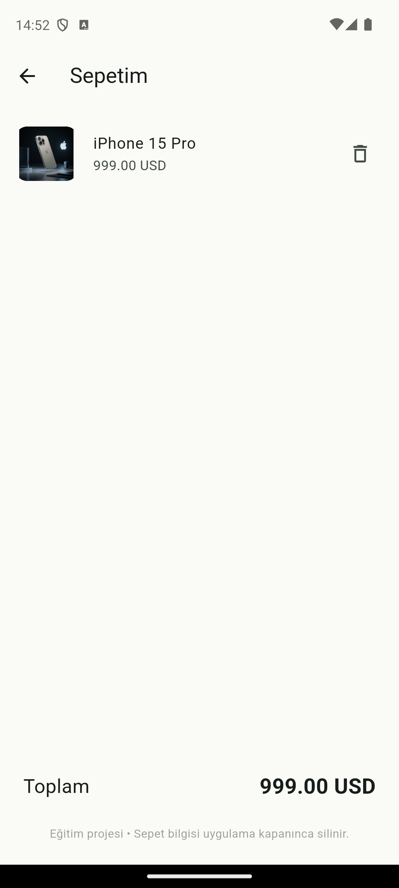
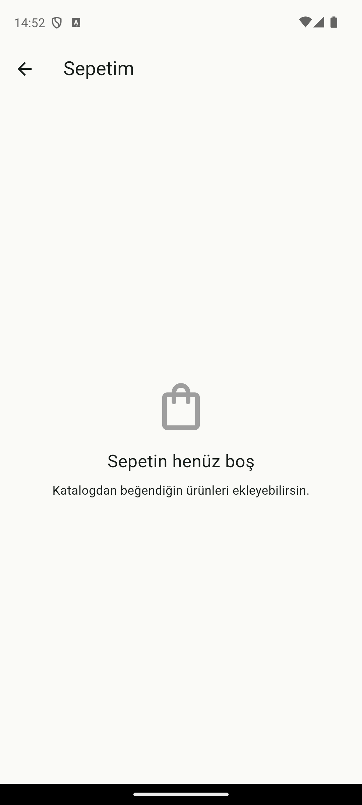

# Mini Katalog

Flutter ve Dart ile hazırlanmış, eğitim amaçlı basit bir ürün kataloğu. Ürünler https://wantapi.com/products.php adresinden, banner ve ürün görselleri WantAPI üzerinden yüklenir. İnternet bağlantısı gerekir.

## Özellikler

- Ayrı ana sayfa ve ürün listesi
- Named Routes ve Route Arguments ile ürün detayına veri taşıma
- Ürünleri kartlar halinde listeleme
- Ürün adı ve kategoriye göre arama
- Ürün detay ekranı
- Sepete ekleme, sepetten çıkarma ve toplam tutar
- Boş sepet ve sonuç bulunamadı durumları
- Canlı API ürünleri, uzak ürün görselleri ve banner
- Yüklenme göstergesi ve bağlantı hatasında yeniden deneme

Ek çalışma zamanı paketi kullanılmamıştır. Sepet yalnızca uygulama açıkken tutulur. Gerçek ödeme ve üyelik sistemi bulunmaz.

## Kullanılan sürümler

- Flutter 3.44.1 (stable)
- Dart 3.12.1

## Çalıştırma

Flutter SDK ve Android Studio/emülatör veya bağlı Android cihaz gereklidir.

```sh
flutter pub get
flutter run
```

Tarayıcıda denemek için:

```sh
flutter run -d chrome
```

iOS için macOS ve Xcode kurulumu gerekir. Cihazda çalıştırırken kendi geliştirme takımınızla imzalama yapın.

## Kontroller

```sh
flutter analyze
flutter test
flutter build web
```

Widget testi; arama, ürün detayı, sepete ekleme, çıkarma, boş sepet ve sonuç bulunamaması akışlarını kapsar. Android Pixel 8 emülatöründe uygulama açılmıştır. iOS doğrulaması ayrıca yapılmalıdır.

## Klasör yapısı

- `lib/models/`: Ürün modeli ve JSON dönüşümleri
- `lib/screens/`: Ana sayfa, katalog, detay ve sepet ekranları
- `lib/widgets/`: Ortak ürün görseli bileşeni
- `lib/services/`: Ek paket olmadan HTTP isteği (mobilde dart:io, webde Fetch)
- `assets/products.json`: Test için yerel örnek ürünler
- `assets/images/`: Test için yerel örnek görseller
- `test/`: Temel kullanıcı akışı testi
- `docs/screenshots/`: Android emülatörü ekran görüntüleri

## Ekran görüntüleri







## Veri kaynağı

- Ürünler: https://wantapi.com/products.php
- Banner: https://wantapi.com/assets/banner.png
- Fiyatlar API’nin verdiği USD para biriminde gösterilir; TL dönüşümü yapılmaz.
- İçerik eğitim ve demo amaçlıdır. Ürün adları ve markalar sahiplerine aittir; proje Apple ile bağlantılı değildir.
